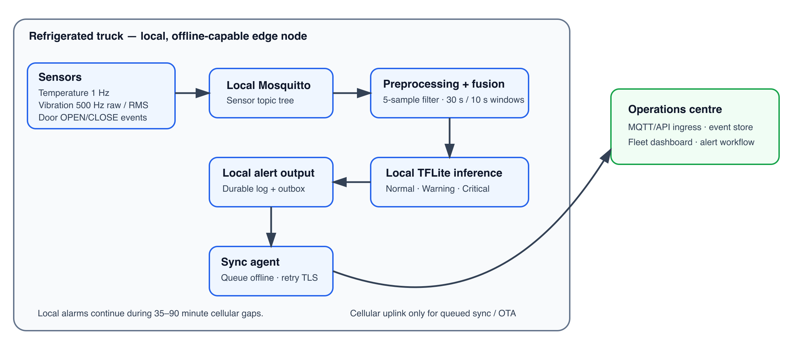
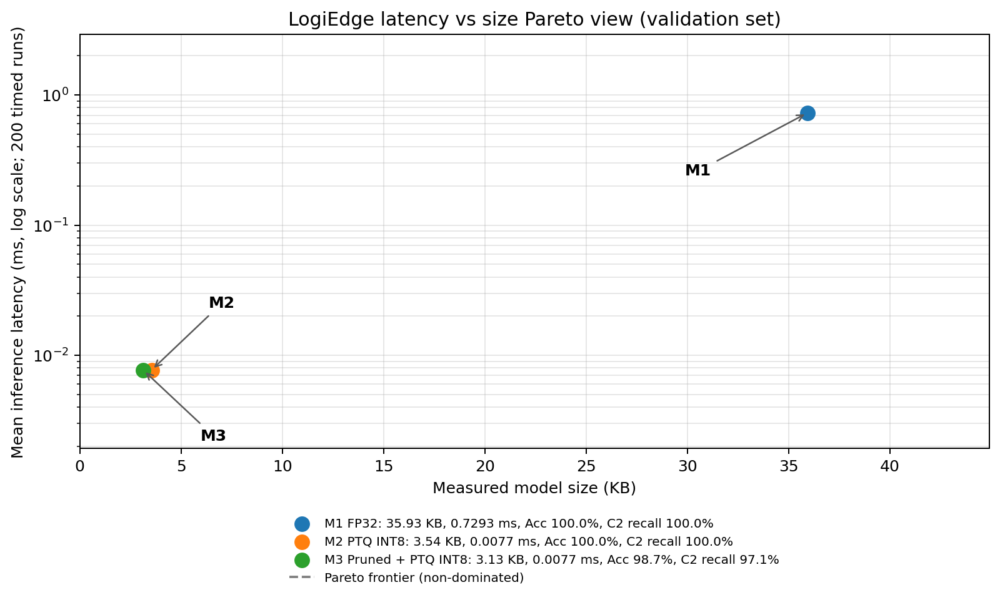

# GROUP16_LogiEdge_Final

> Measured results from a local end-to-end run on macOS (Apple Silicon) with Python 3.11, TensorFlow 2.15.1, Docker Compose, and Ansible. This simulation does not certify pharmaceutical safety.

| Field | Details |
|------|------------------------|
| **Group** | Group 16 |
| **Members** | Ranjith Nagaraj (2025ae05379@wilp.bits-pilani.ac.in)<br>Pricilla W. (2025ae05321@wilp.bits-pilani.ac.in)<br>GUNA Anban G. (2025ae05318@wilp.bits-pilani.ac.in) |
| **Repository** | <https://github.com/rnagaraj13/LogiEdge> |
| **Demo video** | [drive.google.com/file/d/1-eleWS08pblFht3cI-LVhRtAHdsOiGxH/view](https://drive.google.com/file/d/1-eleWS08pblFht3cI-LVhRtAHdsOiGxH/view?usp=sharing) |

## 1 — FreightBridge Deployment Context (target 400–500 words)

FreightBridge's pilot monitors 85 refrigerated trucks and may scale to 265. A refrigeration failure can raise cargo temperature by 1°C per minute, so LogiEdge must detect and alert within 90 seconds of a fault signature appearing. That is an end-to-end sensor-to-local-alert SLA, not model invocation time.

**Latency.** Cloud inference cannot be the safety path. Even with coverage, an assumed rural 3G/4G round trip of roughly 100–300 ms excludes connection setup, retransmission, queuing and cloud processing, so it is not a dependable bound. On the Nashik–Aurangabad route, seven gaps of 35–90 minutes make the round trip unbounded; a 90-second deadline cannot depend on a link that is absent for up to 90 minutes. The truck therefore classifies and alarms locally, and cellular carries only synchronisation and model updates.

**Bandwidth.** Assuming 32-bit values and ignoring framing, 1 Hz temperature uses 4 bytes/s and raw tri-axis vibration at 500 Hz uses `500 × 3 × 4 = 6,000 bytes/s`. The combined 6,004 bytes/s is 518.75 MB per truck-day: ₹51.87 per truck-day at ₹0.10/MB, or about ₹4,409 per day for 85 trucks, before protocol overhead. Edge processing sends compact events instead; an illustrative ten 1 KB alerts per day is 10 KB, about ₹0.001 per truck-day.

**Connectivity and privacy.** During a gap, a cloud-only system loses decisions, alerts and chain-of-custody records. LogiEdge keeps local MQTT, inference and alarms running, persists every decision in a durable outbox, and a retrying sync service forwards deduplicated events when coverage returns. Keeping raw cargo readings on the truck limits third-party exposure, but contractual proof also needs encryption, protected keys, least-privilege credentials, signed OTA and audited retention.

**Hardware.** The Constraint Triangle weighs latency, power and cost. Power is the dominant vertex: the AI budget is 10 W from the 12 V supply, while a compact MLP meets the 90-second SLA on any credible option. Jetson Orin Nano Super (15 W, ₹45,000) breaks the power budget and costs ₹38.25 lakh for the pilot and ₹1.19 crore at 265 trucks. STM32H7 (0.4 W, ₹3,500) is cheapest, but its runtime, OTA and memory headroom for our container stack are unproven. Raspberry Pi 5 with AI HAT+ (7.5 W, ₹15,000) fits the budget with 2.5 W headroom and costs ₹12.75 lakh for 85 trucks or ₹39.75 lakh for 265, so we select it, conditional on measured power and thermal behaviour.

**Roofline.** Arithmetic intensity is `45 MFLOPs / 18 MB = 2.5 FLOP/byte`; the ridge point is `16 GFLOP/s / 12 GB/s = 1.33 FLOP/byte`, so the model is compute-bound. Ideal lower bounds are 2.81 ms compute and 1.50 ms memory per inference. Latency therefore improves by reducing or cheapening arithmetic, through INT8 quantisation and structured pruning, rather than by memory tuning. Figure 1 shows the architecture.



All timed runs used a macOS Apple Silicon laptop with Docker Desktop, not a Pi, so we claim no measured vehicle power or thermal margins.

## 2 — Sensor Pipeline and MQTT Design (target 500–600 words)

Temperature publishes at 1 Hz, vibration arrives as a 0.5 Hz RMS value aggregated from the raw tri-axis 500 Hz signal, and door contacts publish discrete OPEN/CLOSE events. Every stream goes to a Mosquitto broker on the truck itself, so the inference path never leaves the vehicle. Figure 2 shows the full topic tree.

```text
logibridge/
└── trucks/{truck_id}/
    ├── sensor/
    │   ├── temperature      QoS 0   {truck_id, timestamp, value, unit, anomaly}
    │   ├── vibration_rms    QoS 0   {truck_id, timestamp, value, unit, anomaly}
    │   └── door_event       QoS 1   {truck_id, timestamp, event: OPEN|CLOSE}
    ├── inference            QoS 1   {class_id, class_name, confidence, probabilities, features, latency}
    └── alerts               QoS 1   {severity: WARNING|CRITICAL|DOOR_EVENT, ...}
```

*Figure 2 — Truck-local MQTT topic tree with QoS per topic (no topic is retained).*

QoS is chosen per topic. Temperature and vibration use QoS 0: they are periodic, the next sample supersedes a lost one within one or two seconds, and at-least-once delivery would add acknowledgement traffic and back-pressure to the highest-volume streams. Door events use QoS 1 because a missed OPEN is a lost chain-of-custody fact that no later sample replaces. Inference and alert messages also use QoS 1, because the PSI monitor and the sync agent must receive every decision; duplicates are harmless because the sync agent stores each event under a content-hash ID. Nothing is retained, so a reconnecting client never mistakes an old alert for a new one.

The preprocessing path applies a five-sample moving average separately to temperature and vibration. A 30-second window advances every ten seconds. Temperature produces mean, standard deviation and rate in °C/min; vibration produces RMS, peak and Pearson kurtosis. Each choice has a reason. Five samples smooth sensor noise while adding at most a few seconds of lag at 1 Hz. A 30-second window holds enough readings for a stable rate of change, and the 10-second step bounds how long a new fault waits before it is evaluated. Rate of change catches drift before the absolute threshold is crossed, and kurtosis captures the impulsive shocks typical of bearing wear that RMS alone can smooth away. These independently computed features are concatenated as a stable six-value vector. Feature-level fusion is appropriate because it captures joint sensor relations without requiring an MLP to consume the raw high-rate waveform. Data-level fusion would require time-aligning streams with very different rates and would transport/process far more values. Decision-level fusion would require independent classifiers and a later rule/model to combine outputs, obscuring cross-sensor relations. Door events remain logged and alerted separately because the assigned model input has exactly six values; they are not silently represented as an unrequested seventh feature.

The training normalization parameters are calculated from ten minutes of clean Normal simulation and stored in `training_stats.npy`. Inference loads that frozen file; it never learns statistics from live data, because adapting to a drift could hide the drift itself. A required sensitivity test compares the held-out model accuracy under correct statistics and statistics whose mean is shifted by 3σ while preserving the original scale. The problem also has a label inconsistency: +0.08°C per second crosses the Critical >3°C deviation after 38 seconds, although the dataset table assigns an entire 15-minute `temp_drift` run to Warning. This implementation preserves the specified ramp and labels windows by severity, treats vibration-only bearing anomaly as Warning, and treats combined as Critical. The resulting mode policy is recorded in the generation manifest and should be confirmed with the instructor.

| Normalization case | Held-out accuracy | Change from correct stats |
|---|---:|---:|
| Correct ten-minute clean mean/std | 100.00% | Baseline |
| Mean shifted by 3σ | 94.74% | −5.26 percentage points |

**Measured notes.** Seed 631; stratified 20% hold-out gave 302 train / 76 validation windows from 378 total labeled windows (class counts Normal 117, Warning 88, Critical 173 per `generation_manifest.json`). With correct frozen stats, validation accuracy was 100.00%. After shifting only the normalization mean by +3σ (std unchanged), accuracy fell to 94.74% (−5.26 pp) on the same split (`normalization_shift_experiment.json`). The drop shows the classifier is sensitive to the locked Normal baseline: if live systems silently refit mean/std during a fault, severity can be under-stated. Keeping `training_stats.npy` immutable at inference is therefore a safety control, not a convenience.

## 3 — Model Deployment and Pipeline Mapping (target 400–500 words)

The training script generates the Normal, Warning and Critical windows, freezes clean-data statistics, trains the two-hidden-layer 32/16 ReLU MLP, and uses a stratified 20% held-out split. It records accuracy, confusion matrix and class recall, and stops if accuracy is below the required 88%. The deployment candidate must additionally exceed 95% Class 2 recall. PTQ conversion uses at least 200 representative windows and full integer TFLite input/output. The third candidate uses a TensorFlow Model Optimization Toolkit PolynomialDecay schedule to remove whole hidden units, compacts their dimensions, then performs full INT8 PTQ; we measured size and accuracy to confirm the optimisation did not trade away safety-critical recall.

The table below maps LogiEdge to the ten stages of the Module 4 Edge ML pipeline; `reports/pipeline_mapping.md` holds the same mapping with file references.

| Stage | What happens in LogiEdge |
|---|---|
| 1. Data acquisition | Temperature (1 Hz), vibration RMS (0.5 Hz) and door events arrive on truck-local MQTT topics; the simulator reproduces these streams for training and demos. |
| 2. Data validation | The inference service parses each JSON payload and keeps timestamped buffers; malformed messages are logged and dropped, and a backwards clock jump clears the buffers. |
| 3. Feature engineering | A five-sample moving average, then 30-second windows every 10 seconds, produce the six features: temperature mean, standard deviation and rate; vibration RMS, peak and kurtosis. |
| 4. Normalisation | Mean and standard deviation from ten minutes of clean data are frozen in `training_stats.npy` and only loaded at runtime, never refitted on live data. |
| 5. Model training | `train_model.py` trains the 32/16 ReLU MLP on 378 labelled windows and stops if held-out accuracy is below 88%. |
| 6. Validation and selection | Accuracy, the confusion matrix and Critical recall are recorded on a stratified 20% hold-out; a variant is only eligible above 95% Critical recall. |
| 7. Conversion and optimisation | M2 is full INT8 PTQ with 378 representative windows; M3 prunes 35% of hidden units on a PolynomialDecay schedule, compacts the layers, then applies the same PTQ. |
| 8. Packaging | The `python:3.11-slim` image installs dependencies before `COPY model.tflite .`, so a model update changes one 3.5 KB layer; `MODEL_PATH` switches variants without a rebuild. |
| 9. Deployment and inference | Ansible stages the model and reference on the truck and starts the container, which publishes every decision and writes alerts to a local log with no uplink. |
| 10. Monitoring and update | PSI on prediction confidence flags drift; the sync agent forwards queued events when coverage returns; a confirmed drift triggers retraining and a canary OTA rollout. |

The Docker image uses Python 3.11 slim and installs pip dependencies before `COPY model.tflite .`. This preserves dependency layers when the model alone changes. `MODEL_PATH` selects a mounted TFLite variant without rebuilding. The inference service subscribes locally, executes preprocessing and model inference, writes persistent local events, and publishes decisions without the cellular uplink. The sync agent keeps a SQLite outbox and forwards events over configured TLS when coverage returns.

The OTA nominal calculation treats the supplied 280 KB model as 0.28 decimal MB. Full fleet transfer for 85 trucks is 23.8 MB and ₹2.38. A ten-truck canary costs ₹0.28 for its 2.8 MB initial phase; the remaining 75 trucks cost ₹2.10, for the same ₹2.38 after complete rollout. Shadow mode also sends the candidate to every truck, so it costs the same ₹2.38 plus comparison telemetry. We recommend the canary. A full replacement pushes an unproven model to all 85 trucks at once: a regression in Critical recall would blind the whole pharmaceutical fleet together. Shadow mode runs two models on a 10 W device and uploads comparison data over expensive, intermittent links, yet still delays the benefit. A ten-truck canary limits exposure, lets us confirm Critical recall and PSI on real routes before the other 75, and retries naturally as trucks re-enter coverage.

**Measured Docker / OTA bytes.** Inspecting `logibridge-inference:latest` on the lab host: total image size 219,492,906 bytes (~209.3 MiB). `docker history` shows the dependency install layer ≈69.2 MB and the isolated `COPY model.tflite` layer = 3,544 bytes (matches `training/models/m2_int8.tflite`). Stats file layer is 176 bytes. Because dependencies are installed before the model copy, a model-only rebuild replaces the 3.5 KB layer rather than re-transferring the ~69 MB pip layer. Versus shipping a full 219 MB image to 85 trucks (≈18.7 GB), a 3,544-byte model-only update is ≈301 KB fleet-wide—orders of magnitude cheaper than full-image OTA. Using the assignment’s ₹0.10/MB SIM tariff on the measured 3,544-byte model gives a negligible per-truck cost compared with ₹2.38 under the 280 KB nominal assumption; we still quote the assignment’s ₹2.38 canary arithmetic for comparability, while noting our actual INT8 artifact is much smaller than 280 KB.

## 4 — Optimisation and Pareto Analysis (target 400–500 words)

The benchmarking script performs ten excluded warm-ups and 200 measured calls per variant. It reports mean inference latency, p95 latency, model size, held-out accuracy and energy/inference. The energy estimate uses `psutil` process CPU percentage and an explicitly configured laptop TDP estimate; it is a comparative estimate, not a calibrated edge-board power measurement. M1 is the FP32 Keras baseline, M2 uses full INT8 post-training quantization and M3 combines structured hidden-unit pruning with PTQ INT8. The Pareto chart uses measured latency and size for visualization; non-dominance is calculated across latency, size, energy and accuracy. An attractive size/latency point is not eligible if its Critical recall fails the stated threshold.

| Variant | Mean latency ms (200) | p95 ms | Size KB | Accuracy % | Energy mJ/inference |
|---|---:|---:|---:|---:|---:|
| M1 FP32 baseline | 0.729 | 0.460 | 35.934 | 100.00 | 1.821 |
| M2 full INT8 PTQ | 0.00772 | 0.00817 | 3.544 | 100.00 | 0.0192 |
| M3 structured prune + PTQ INT8 | 0.00771 | 0.00788 | 3.128 | 98.68 | 0.0193 |

Class 2 recall is separately evaluated from `recall = true critical predictions / all actual critical validation windows`. **M2 Critical recall = 100.00% (35/35 held-out Critical windows; confusion matrix diagonal for class 2).** This is strictly above the 95% gate. M1 also scored 35/35. M3 scored 97.14% Critical recall (34/35) with compacted hidden widths 21 and 11 after 35% structured sparsity—still above 95%, but slightly weaker than M2 on this split.



M1 is clearly dominated: it is ten times larger and about a hundred times slower than either INT8 model without being more accurate than M2. M3 is the smallest point, but it buys 0.4 KB with one missed Critical window. In this deployment that trade is wrong: a missed Critical window can mean a spoiled vaccine load, while a false Warning costs one phone call, so Class 2 recall outweighs a few hundred bytes.

**SLA budget.** The 90-second requirement covers the whole path. In the worst case, windowing takes about 40 seconds: up to 10 seconds waiting for the next window end plus up to 30 seconds while faulty readings fill the window. Reserving ten seconds for local alerting leaves about 40 seconds; we set a deliberately conservative per-inference budget of 1 second to absorb CPU contention on the Pi. M2 measured 0.0077 ms mean and 0.0082 ms p95 over 200 calls, five orders of magnitude inside that budget. In live runs the first Critical alert appeared about 30 seconds of sensor time after fault onset, well inside 90 seconds, with no uplink.

**Memory.** The Pi 5 has 8 GB of RAM and microSD or NVMe storage, so M2's 3.5 KB model, its tiny tensor arena and the 219 MB container image fit comfortably; peak memory must still be measured on the device. For comparison, a typical STM32H7 part such as the H743 has 2 MB flash and 1 MB SRAM: the INT8 model alone would fit, but the Python, Docker and MQTT stack would not.

**Recommendation.** Deploy **M2 full INT8 PTQ** to the 85 trucks. It passes the 88% accuracy gate at 100%, exceeds the 95% Critical-recall gate at 100% (35/35), is ten times smaller than M1 and meets the latency budget with vast headroom. M3 remains a fallback if storage ever binds. Energy values use `LOGIBRIDGE_LAPTOP_TDP_WATTS=25` and are comparative only.

## 5 — MLOps Monitoring and Reflection (target 300–400 words)

PSI compares the confidence distribution of the latest 100 predictions with a reference built from 300 clean windows, using four bins from [0, 0.25) to [0.75, 1] and one check every 60 seconds. PSI above 0.25 prints `[LOGIBRIDGE DRIFT ALERT]`; once clean data returns, PSI below 0.10 confirms recovery. The injected fault is **covariate shift**: the input distribution moves, with rising temperature and higher vibration, while the meaning of each class stays the same, so it is not concept drift. Confidence PSI shows that inputs no longer resemble the training data; it does not identify the cause.

| Phase | Measured PSI evidence (real-time sensor rates) |
|---|---|
| Before: clean baseline | Reference `m2_int8.tflite`, n=300, bins [0, 0.857, 0, 0.143]; live clean PSI 0.000–0.010 |
| During: mid-run injection (7 Nov) | 18 min clean warm-up, then `combined`: **DRIFT ALERT 4.0 min after injection** (PSI 0.263); peak 0.545. Log: `psi_midrun_2026-11-07.txt` |
| After: clean restored | **DRIFT RECOVERED at PSI 0.061**, about 15 min after clean data returned |
| Long-fault runs (5 and 6 Nov) | 18-minute fault: peak 13.37; recovered at 0.031 and 0.061. Logs: `psi_recovery_evidence.txt`, `psi_rerun_2026-11-06.txt` |

The five-minute target holds only once the 100-prediction window is already full of clean data. Our first runs injected the fault after one minute, so the first check came at about 17 minutes; with an 18-minute clean warm-up, the alert followed 4.0 minutes after injection. The demo video replays data at 3× speed with the fault at the start, so it shows the alert and recovery, but this real-time run is the timing evidence.

Both runs of the seven-task Ansible playbook completed without failures. The first reported `changed=1` and the second `changed=0`, confirming idempotency (`ansible_run1.txt`, `ansible_run2.txt`). The stop task runs only when the model or reference copy actually changed, and the final wait-and-verify check is marked unchanged, so re-running the playbook across 85 trucks restarts nothing that is already up to date.

**Genuine technical difficulty.** After one simulator run, a second run produced no predictions at all, and the drift monitor sat silent for half an hour. The inference service remembers the sensor timestamp at which its next window closes; the previous run had ended near 2,400 seconds and the new one restarted at zero, so no window ever closed. An empty inference log pointed us to it. The service now detects a backwards clock jump, as after a gateway reboot, and clears its buffers.

**One architectural change.** We would replace the fixed 100-prediction buffer with a time-weighted window. After a long fault, real-time recovery took about 16 minutes because faulty predictions must age out one by one; weighting recent predictions would confirm recovery sooner without weakening the 0.25 alert.

These are synthetic, laptop-based results; a real pilot still needs qualified sensors, calibration, Pi hardware tests and a security review.

## Conclusion

LogiEdge meets the brief on simulated data. The truck classifies every 30-second window locally and raised its first Critical alert about 30 seconds of sensor time after a fault, well inside the 90-second SLA, with no uplink. M1 and M2 reached 100% held-out accuracy with 35/35 Critical recall; M3 kept 98.68% accuracy and 97.14% Critical recall after pruning and PTQ, so we recommend M2. In a real-time mid-run injection, PSI crossed 0.25 just 4.0 minutes after the fault began and fell below 0.10 once clean data returned, and two longer-fault runs reproduced both the alert and the recovery. Ansible showed a seven-task rollout with a second-run `changed=0`, and a model-only OTA update replaces a 3.5 KB layer rather than a 219 MB image. Our decision is a **conditional go for a supervised lab pilot and a no-go for unsupervised pharmaceutical deployment** until Pi power, thermal and end-to-end timing tests, a security review and real-sensor validation are complete.

## References (excluded from word count)

1. FreightBridge LogiEdge Mini-Project Problem Statement — Student, supplied course document.
2. TensorFlow Lite documentation: https://www.tensorflow.org/lite
3. Mosquitto documentation: https://mosquitto.org/documentation/
4. Ansible documentation: https://docs.ansible.com/
5. TensorFlow Model Optimization documentation: https://www.tensorflow.org/model_optimization
6. Local evidence files: `training/results/training_metrics.json`, `training/results/normalization_shift_experiment.json`, `optimisation/results/benchmark_results.csv`, `monitoring/reference_dist.json`, `reports/evidence/psi_recovery_evidence.txt`, `reports/evidence/psi_rerun_2026-11-06.txt`, `reports/evidence/psi_midrun_2026-11-07.txt`, `reports/evidence/inference_run_2026-11-05.txt`, `reports/evidence/ansible_run1.txt`, `reports/evidence/ansible_run2.txt`.
